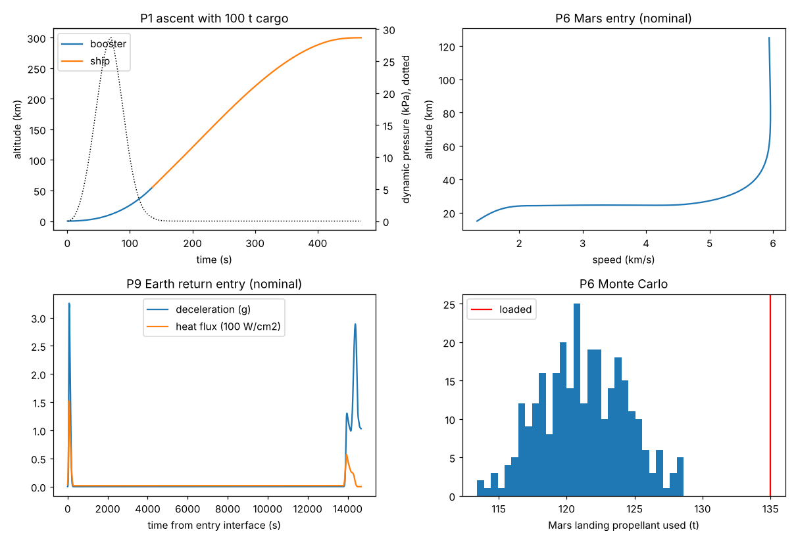
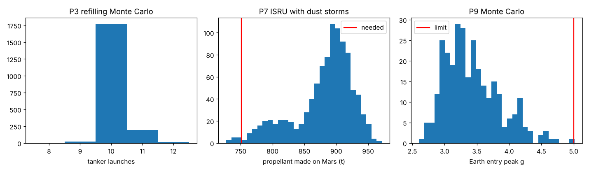
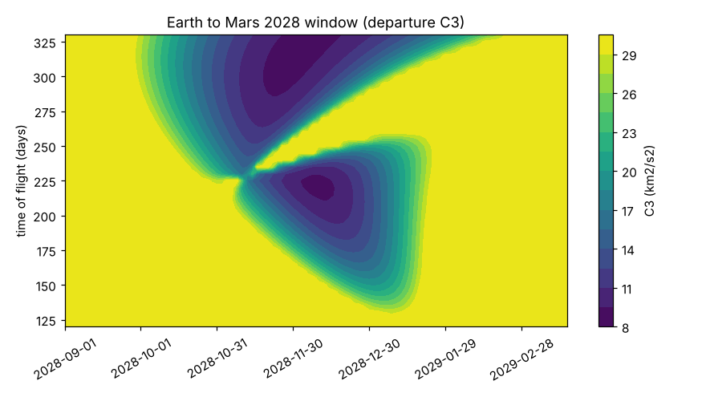

# Mars launch campaign: simulation and verification results

5 evaluation rounds (quick Monte Carlo iterations plus full verifications). Final verification: 13 of 13 objectives pass.

## Objectives (final verification)

| ID | Phase | Objective | Result | Limit | Pass | Note |
| --- | --- | --- | --- | --- | --- | --- |
| O1 | P1 ascent | Mars ship reaches 300 km orbit with 100 t cargo (Monte Carlo) | 0.99 probability | 0.99 | PASS | nominal residual 22.4 t; 2.7% of launches draw up to 2% from the booster reserve |
| O2 | P1 ascent | Maximum dynamic pressure | 28.6 kPa | 35 | PASS | limit is an estimate (Falcon 9 class ~32 kPa) |
| O3 | P1 ascent | Gimbal angle to trim a 60 m/s crosswind at max-Q (control authority) | 0.414 deg | 15 | PASS |  |
| O4 | P2 booster return | Booster lands at the launch site with propellant left (Monte Carlo) | 1 probability | 0.99 | PASS | nominal margin 12.1% of reserve, miss 3108 m; touchdown limit 3 m/s, miss limit 5 km (no terminal divert in L1); failures {} |
| O8 | P6 Mars EDL | Entry, descent and landing succeed under dispersions (Monte Carlo) | 1 probability | 0.99 | PASS | landing propellant used p99 128.5 t of 135 t loaded; failures {} |
| O9 | P6 Mars EDL | Entry corridor width (g and heating limits, no skip-out) | 3.3 deg | 0.6 | PASS | corridor (-13.5, -10.2); 0.6 deg = +/-3 sigma of the 0.1 deg delivery error |
| O6 | P4 TMI | Propellant needed in LEO fits the ship tanks (worst day of launch period) | 834 t | 1600 | PASS |  |
| O5 | P3 refilling | Ship is full and departs inside the launch period (Monte Carlo) | 0.984 probability | 0.95 | PASS | median 10 tanker launches, 95th pct 11 |
| O7 | P5 cruise | Trajectory correction delta-v, 99th percentile | 4.43 m/s | 30 | PASS |  |
| O10 | P8 Mars ascent | Return propellant made on Mars fits the tanks | 751 t | 1600 | PASS | ascent 3997 m/s, TEI 1937 m/s |
| O11 | P7 ISRU | Return propellant produced before the return window (Monte Carlo, dust storms) | 0.989 probability | 0.95 | PASS | 751 t needed in 383 days; 5th percentile production 783 t |
| O12 | P9 Earth entry | Earth entry within heating and g limits (Monte Carlo) | 0.997 probability | 0.99 | PASS | nominal 12.30 km/s, 152 W/cm2 vs 400, 3.3 g, corridor (-6.2, -5.6), failures {'g': 1} |
| O13 | Overall | End-to-end mission success (product of phase probabilities) | 0.96 probability | 0.9 | PASS | booster loss is an asset loss and is tracked by O4, not here |

## Iteration history

| Round | Failing objectives | Changes made |
| --- | --- | --- |
| 0 | O8 | O8: Mars landing propellant 115 t -> 135 t (failures {'crash': 2, 'propellant': 2, 'touchdown speed': 2}) |
| 1 | O1 | O1: adaptive booster cut-off may draw 1% of booster propellant from the return reserve on a short launch (booster possibly expended) |
| 2 | O1 | O1: adaptive booster cut-off may draw 2% of booster propellant from the return reserve on a short launch (booster possibly expended) |
| 3 | none | (all pass) |
| 4 (full verification) | none | (all pass) |

## Mission timeline and key numbers

| Phase | Result |
| --- | --- |
| P1 ascent | Max-Q 28.6 kPa at Mach 1.34, 11.0 km; staging at 136 s, 55 km, 1433 m/s; orbit at 470 s. Gravity loss 2312 m/s, drag loss 10 m/s. Payload with tanker landing reserve: 100 t. Cargo ship arrives with 22 t propellant. |
| P2 booster return | Boostback 26 s, landing burn 46 s, 440 t used of 501 t reserve (12% margin), touchdown 1.0 m/s, 3108 m from the pad. Reserve 14% of booster propellant. |
| P3 refilling | 806 t needed in LEO (834 t on the worst day). Each tanker delivers 96 t. 10 tanker launches median, 11 at 95%. P(on time) 0.984. Mean boil-off 41 t. Launch period 2028-11-08 to 2028-12-24. |
| P4 trans-Mars injection | Depart 2028-12-02, C3 8.9 km2/s2, 3603 m/s impulsive + 22 m/s gravity loss on 3 vacuum engines, 641 t burned. |
| P5 cruise | 320 days, arrive 2029-10-18. Correction delta-v 99th percentile 4.4 m/s (budget 30). |
| P6 Mars EDL | Entry 5.94 km/s at -12.4 deg, ballistic coefficient 638 kg/m2, peak 3.5 g and 48 W/cm2, corridor (-13.5, -10.2). Retropropulsion from 14.8 km; 121 t used nominal, 128 t at 99%, 135 t loaded. |
| P7 ISRU | 383 days on the surface. 7.6 kWh per kg of propellant [est]. 40,000 m2 arrays + 380 kWe fission. Needs 751 t; 5th percentile production 783 t. P(ready) 0.989. |
| P8 Mars ascent and TEI | Ascent 3997 m/s to a 300 km orbit, TEI 1937 m/s; depart 2030-11-05. |
| P9 Earth return | Arrive 2031-09-21 at 12.30 km/s, -5.9 deg; peak 3.3 g, 152 W/cm2 vs 400 limit, corridor (-6.2, -5.6). |
| Overall | P(mission success) 0.960 (product of phase probabilities). |

## Risks and mitigations (each checked in simulation)

| ID | Phase | Risk | Mitigation | Without mitigation | With mitigation | Verified |
| --- | --- | --- | --- | --- | --- | --- |
| R1 | P1/P2 | One booster engine fails 30 s after liftoff | Engine-out capability: the other 32 engines burn longer; return reserve sized with margin | No engine-out capability: abort, mission lost | orbit reached: True, ship residual 15.9 t; booster return margin 9.5% of reserve | yes |
| R2 | P1 | One ship sea-level engine fails 60 s after staging | Remaining five engines burn longer; cargo ship reaches orbit with less residual and takes one more tanker | Abort to a sub-orbital disposal | orbit reached: True, residual 24.5 t (nominal 22.4 t) | yes |
| R3 | P3 | Tanker flights less reliable (90%) and slower to turn around (20 days) | Third pad, campaign starts 40 days earlier, sunshade on the waiting ship | P(on time) 0.522 | P(on time) 0.981 | yes |
| R4 | P3 | Boil-off in LEO three times the estimate (0.3%/day) | Sunshade and insulation on the waiting ship (0.03%/day) [est] | P(on time) 0.967 | P(on time) 0.990 | yes |
| R5 | P4 | One vacuum engine fails at the start of trans-Mars injection | Fly on two vacuum engines (or add the three sea-level engines) and spend the 2% LEO margin | 2 RVac: 652 t burned vs 651 t nominal (gravity loss 25 m/s) | 2 RVac + 3 SL: 662 t; margin available 155 t | yes |
| R6 | P6 | Mars atmosphere density varies 35% (1-sigma) instead of 15%, e.g. during a dust storm | Keep the -12.4 deg baseline entry (already steepened) and carry 20 t more landing propellant when orbiters report thin air | P(EDL) 0.980 at -12.4 deg with 135 t | P(EDL) 0.993 at -12.4 deg with 155 t | yes |
| R7 | P6 | One landing engine fails to light | Design change (in baseline): 4 sea-level engines (+1.9 t each beyond 3), so one failure leaves 3 | 3 engines, one out: crashed=True, used 135 t, impact 459 m/s | 4 engines, one out: crashed=False, used 121 t of 135 t, touchdown 0.7 m/s | yes |
| R8 | P7 | Global dust storm during the surface stay (sunlight ~30% for 60-120 sols) | Fission power sized for a certain storm: 400 kWe (baseline 380 kWe) beside 40,000 m2 of arrays | solar only: P(ready) 0.000 | with 400 kWe fission: P(ready) 0.990 | yes |
| R9 | P9 | Earth entry at ~12.3 km/s overheats the tile heat shield | Ablative windward heat shield on the return ship (+6 t) [est rating 400 W/cm2] | peak 152 W/cm2 vs tile limit 100 W/cm2 | peak 152 W/cm2 vs ablator limit 400 W/cm2 | yes |

## Stress cases (whole campaign re-run, no redesign)

| Case | Objectives that fail | Tankers (median) | P(mission) |
| --- | --- | --- | --- |
| Isp 1% low on every engine | O1 (nominal ascent fails) | None | 0.000 |
| Ship dry mass +10 t | O1 (Mars ship reaches 300 km orbit with 100 t cargo (Monte Carlo)); O8 (Entry, descent and landing succeed under dispersions (Monte Carlo)); O5 (Ship is full and departs inside the launch period (Monte Carlo)); O11 (Return propellant produced before the return window (Monte Carlo, dust storms)); O13 (End-to-end mission success (product of phase probabilities)) | 11 | 0.841 |
| Booster reserve held at 12% | none | 9 | 0.980 |

## Sensitivity (deterministic, one change at a time)

| Case | Tanker delivery (t) | Tankers | LEO propellant (t) | Mars propellant (t) |
| --- | --- | --- | --- | --- |
| baseline | 94 | 9 | 806 | 761 |
| Isp -1% | ascent does not reach orbit | - | 812 | 767 |
| Isp +1% | 100 | 8 | 790 | 746 |
| Ship dry +10 t | 85 | 10 | 822 | 796 |
| Ship dry -10 t | 103 | 8 | 784 | 716 |
| Booster reserve +2 pts | 85 | 10 | 806 | 761 |
| Landing propellant +20 t | 94 | 10 | 868 | 761 |
| Cargo +20 t | 94 | 9 | 844 | 761 |

